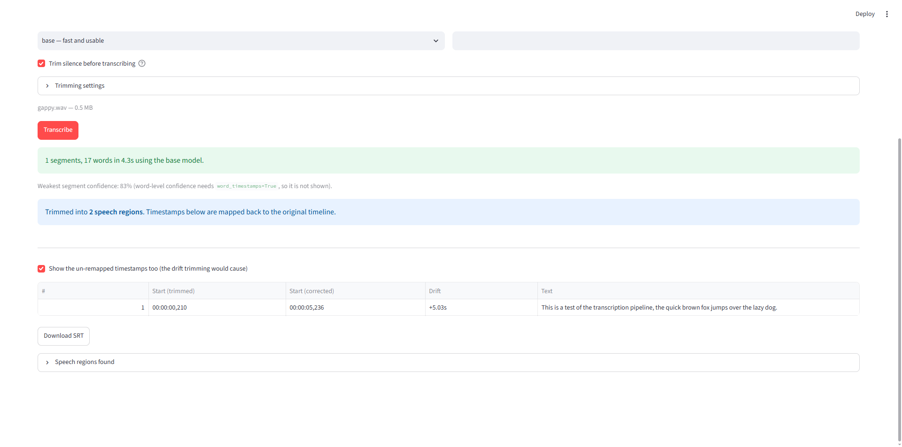

# Transcription Pipeline

Batch speech-to-text built around a single local model ([faster-whisper]), with
the reliability layer that decides whether a batch actually finishes.

Self-initiated project — I built this to solve problems I hit myself, not for a
client. Extracted from a larger private project; this repo is the transcription
module on its own.

---

## The interesting part: trimming without breaking timestamps

Trimming silence out of a recording before transcription is a real speedup —
less audio for the model to chew through. It is also a trap.

The model reports timestamps against the audio it was *given*. Trim the silence
first and every timestamp is now relative to a shorter file, so subtitles drift
progressively earlier against the original recording. By the end of a long file
the drift can be many seconds.

The fix is to keep the mapping explicit. The trimmer returns the speech regions
it found alongside the trimmed audio:

```python
from src.transcription.silence_removal import remove_voiceover_silence
from src.transcription.utils import remap_segments_to_original_time

result = remove_voiceover_silence("talk.wav")
segments = client.transcribe(result.trimmed_path)

# Back onto the original timeline, using the regions as anchors.
segments = remap_segments_to_original_time(
    segments, result.speech_regions_ms, crossfade_ms=50
)
```

`remap_segments_to_original_time` rebuilds a lookup table of where each region
landed in the trimmed timeline — accounting for the crossfade overlap between
concatenated regions — and shifts each timestamp by its region's offset. The
correctness lives in one small, testable function rather than being spread
across every caller.

### Running it

```bash
pip install -r requirements.txt

python transcribe.py talk.mp3
python transcribe.py talk.mp3 --trim-silence --srt talk.srt
python transcribe.py talk.mp3 --trim-silence --compare   # show the drift corrected
```

`--compare` prints the timestamp difference the remapping fixed, which is the
quickest way to see what the code is for.

### Web demo

`demo.py` is a Streamlit app that does the same thing in the browser — upload a
file, tick **Trim silence**, and compare the "trimmed" and "corrected" timestamp
columns to watch the drift get fixed.

```bash
pip install -r requirements-demo.txt
streamlit run demo.py
```



That screenshot is a real run: a clip with two 2.5-second gaps, where trimming
moved the first segment from `00:00:05,236` back to `00:00:00,210` — **5.03
seconds of drift corrected**, which matches what `--compare` prints on the CLI.

It runs on CPU by default, so short clips are the realistic test.

### Deploying the demo

The app is configured for [Streamlit Community Cloud](https://share.streamlit.io):

- `streamlit` is in `requirements.txt`, because that platform installs from
  `requirements.txt` only and ignores `requirements-demo.txt`.
- `.streamlit/config.toml` caps uploads at 50 MB. The platform default is 200 MB,
  which would exhaust a free-tier container before transcription even started.
- The model picker stops at `small`. There is no GPU and roughly 1 GB of RAM,
  and the weights sit in RAM while loaded: `tiny` ~75 MB, `base` ~142 MB,
  `small` ~460 MB. `medium` and above do not fit. Locally they are fine.

Deploy by pointing the platform at this repository, setting `demo.py` as the
entrypoint, and waiting for the build. The first request of a cold container
downloads the model weights, so it is slow; later ones reuse the cached model.

One thing to know before deploying it yourself: the app sleeps after a period of
inactivity and wakes on the next request. A visitor arriving at a cold app waits
through a container start and a weight download.

---

## What else is in here

Running one file is a function call. The rest is what makes a *batch* survive:

| Module | What it handles |
| ------ | --------------- |
| `cache.py` | Result cache, so an interrupted run resumes instead of redoing work |
| `delta_index.py` | Only re-transcribes the parts of a recording that changed |
| `retry_budget.py` | Classifies failures and caps total retries across the batch |
| `metrics.py` | Per-file timing, confidence and checkpointing |
| `parallel_processor.py` | Worker pool, batch sizing, checkpointed resume |
| `whisper_client.py` | Model loading, GPU/CPU selection, health checks |

### Retry classification

Retrying everything is how a batch turns into an infinite loop. Errors are
categorised so the recoverable ones are retried and the rest are not:

```python
class TranscriptionErrorCategory(Enum):
    GPU_OOM = "gpu_oom"                        # retry, possibly smaller batch
    TRANSIENT = "transient"                    # retry
    TIMEOUT = "timeout"                        # retry
    LANGUAGE_DETECTION = "language_detection"  # retry with a fallback detector
    PERMANENT = "permanent"                    # do not retry
    UNKNOWN = "unknown"
```

`TranscriptionRetryBudget` enforces a cap on both attempt count and cumulative
backoff time across the whole batch, so one bad file cannot exhaust the budget
for everything after it.

---

## Requirements

- Python 3.10+
- [ffmpeg](https://ffmpeg.org/) — required by pydub for trimming

```bash
pip install -r requirements.txt
```

GPU is optional; it falls back to CPU automatically. Model weights download on
first run.

## Tests

```bash
pip install -r requirements-dev.txt
pytest
```

The suite covers timestamp remapping, silence trimming, the cache, the retry
budget and metrics. The tests mock audio and subprocess calls, so they run
without ffmpeg or a model download — verified: the suite produces identical
results with ffmpeg on and off the PATH.

`tests/test_timestamp_remapping.py` is the one worth reading first — it pins
down the timeline mapping with concrete numbers.

## Layout

```
src/
  config.py               settings objects
  logging_templates.py    structured error logging
  state.py                TranscriptSegment dataclass
  utils.py                audio extraction, SRT, timestamp remapping
  transcription/
    silence_removal.py    find and trim silence, return speech regions
    whisper_client.py     model wrapper
    cache.py              result cache
    retry_budget.py       error classification + retry caps
    metrics.py            timing and confidence metrics
    parallel_processor.py batch orchestration
    delta_index.py        incremental re-transcription
    exceptions.py         error types
tests/
transcribe.py             CLI
```

## Notes

- Code extracted from a larger project; module paths kept as `src.transcription`
  so the original test suite still applies.
- No client data, credentials or third-party material is included.
- `US-xxx` references in comments are historical ticket IDs from the original
  project and are not meaningful outside it.